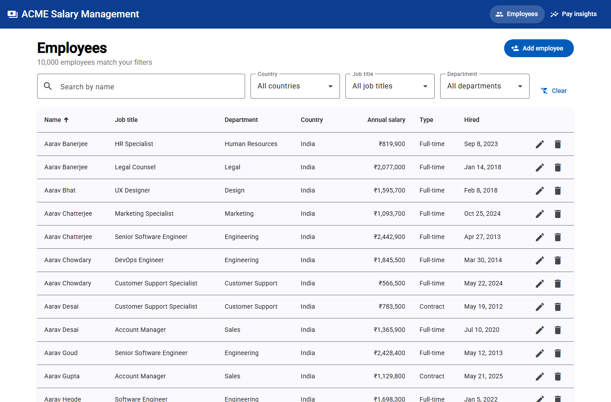
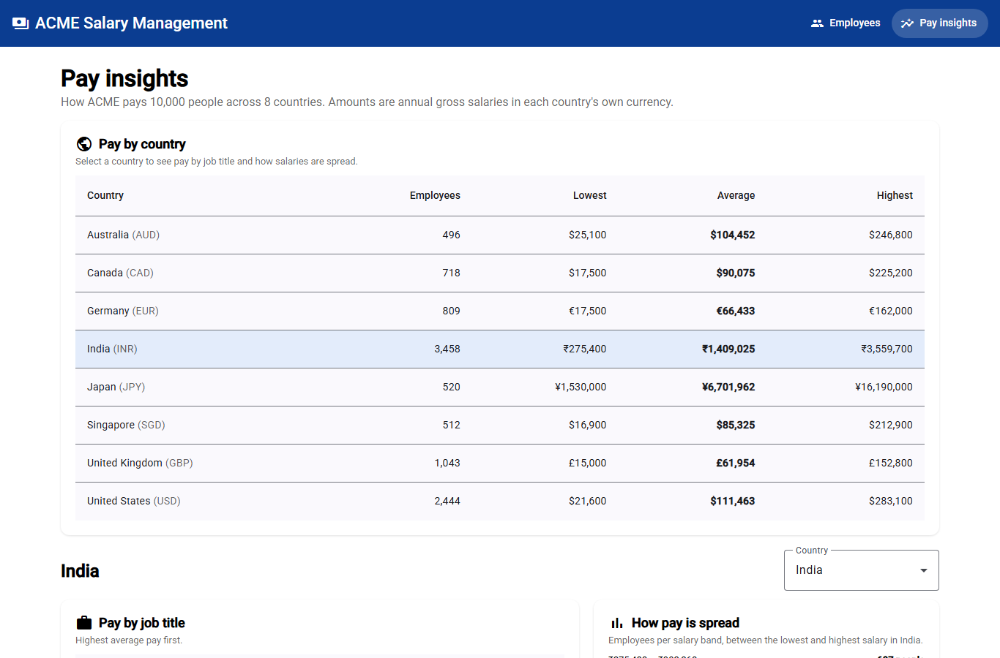

# ACME Salary Management

A web application that replaces ACME's Excel-based salary tracking. It lets the **HR Manager** maintain salary
data for **10,000 employees across 8 countries** and answer **"how does the organisation pay people?"**.

**Live demo:** _<add Render URL after deploy>_ · **Video walkthrough:** _<add link>_

| Employees | Pay insights |
|-----------|--------------|
|  |  |

## What it does

| HR Manager need | Feature |
|-----------------|---------|
| Find anyone quickly among 10,000 people | Employee list with name search, filters (country, job title, department), server-side sorting and paging |
| Keep salary data correct | Add / edit / delete employees with validation on both UI and API; currency is derived from the country |
| "What do we pay in each country?" | Min / average / max salary and headcount per country, in local currency |
| "What does each role earn in a country?" | Job-title breakdown for a selected country, highest average pay first |
| "How is pay spread?" | Headcount per salary band, relative to that country's own range |

The scope, and what was **deliberately left out** (auth, currency conversion, payroll, import, history) with reasons,
is in **[docs/REQUIREMENTS.md](docs/REQUIREMENTS.md)**.

## Tech stack

| Layer | Choice |
|-------|--------|
| Backend | Java 21, Spring Boot 3.3 (Web, Data JPA, Validation, Actuator) |
| Database | SQLite (relational, zero-ops, ideal for one HR user and 10k rows) |
| Frontend | Angular 18 (standalone components, signals) + Angular Material |
| Tests | JUnit 5, Mockito, AssertJ, Spring slice tests · Jasmine/Karma for the UI |
| Packaging | One jar serves UI + API · multi-stage Dockerfile · Render blueprint |

Architecture, data model, API and trade-offs: **[docs/DESIGN.md](docs/DESIGN.md)**.

## Run it locally

Prerequisites: **Java 21**, **Node 20+** (Maven wrapper not needed if Maven 3.9+ is installed).

### Option A: one jar (closest to production)
```bash
cd frontend && npm ci && npm run build:backend   # builds the UI and copies it into the backend
cd ../backend && mvn -DskipTests package
java -jar target/salary-management-0.0.1-SNAPSHOT.jar
```
Open http://localhost:8080. On first start the database (`backend/salary.db`) is created and seeded with
10,000 employees (about 1 second). Restarts keep existing data.

### Option B: development mode (hot reload)
```bash
cd backend && mvn spring-boot:run        # API on http://localhost:8080
cd frontend && npm ci && npm start       # UI on http://localhost:4200, /api proxied to 8080
```

### Option C: Docker (used by the Render deploy)
```bash
docker build -t acme-salary .
docker run -p 8080:8080 acme-salary
```

### Configuration
| Variable | Default | Purpose |
|----------|---------|---------|
| `PORT` | `8080` | HTTP port |
| `DB_PATH` | `./salary.db` | SQLite file location |
| `SEED_ENABLED` | `true` | Seed 10,000 employees when the table is empty |

## Tests

```bash
cd backend && mvn test          # 57 tests: unit, web-slice, repository (real SQLite), seeding, SPA routing
cd frontend && npm run test:ci  # 16 tests: services, list, form, insights
```
Tests use small hand-built datasets (e.g. India salaries of 1,000 / 2,000 / 4,000), so expected numbers can be
checked by eye, and they run in seconds. If Karma cannot launch a browser on your machine, set `CHROME_BIN` to a
Chrome/Edge executable, or run with `KARMA_MANUAL=1` and open http://localhost:9876.

## API

| Method | Path | |
|--------|------|-|
| GET | `/api/employees?search=&country=&jobTitle=&department=&page=&size=&sort=` | Paged, filtered list (max 100 per page) |
| GET · POST · PUT · DELETE | `/api/employees`, `/api/employees/{id}` | CRUD (201 + Location on create, 204 on delete) |
| GET | `/api/insights/countries` | Pay summary per country |
| GET | `/api/insights/countries/{country}/job-titles` | Pay per job title in a country |
| GET | `/api/insights/countries/{country}/distribution` | Headcount per salary band |
| GET | `/api/meta` | Dropdown options (countries + currency, titles, departments) |
| GET | `/actuator/health` | Health check |

Errors use one RFC 7807 shape, e.g. `{"status":400,"title":"Validation failed","errors":{"salary":"must be greater than 0"}}`.

## Project structure
```
backend/   Spring Boot API: employee/ (CRUD + search), insights/ (aggregations), seed/ (10k data), common/
frontend/  Angular app: core/ (models + HTTP services), employees/ (list + form), insights/, shared/
docs/      REQUIREMENTS, DESIGN (incl. measured performance), AI_WORKFLOW, screenshots
```

## Key decisions (short version)
- **Currency follows country.** It is set by the system, never typed, so per-country averages can't be skewed.
- **Aggregation happens in SQL** (`GROUP BY`), so insights return a few rows instead of 10,000 objects.
- **Server-side paging and debounced search**, so the browser never loads the whole workforce.
- **Salary bands relative to each country's range**: a fixed band means nothing across INR and USD.
- **Deterministic seed** (fixed random seed): the same 10,000 employees on every fresh database.
- **One deployable**: UI inside the jar. One URL, no CORS, one thing to run.

## Performance (local, 10,000 employees)
Seeding takes **0.59 s**. List search ~80 ms, insights 19–37 ms. Details, plus the 36 s → 0.59 s seeding bug that was
caught by measuring, are in [docs/DESIGN.md](docs/DESIGN.md#9-measured-results-local-10000-seeded-employees).

## How AI was used
Built with an agentic AI coding tool (Claude Code), in small reviewed steps with tests at each one. What was
delegated, how output was verified, and where the AI got things wrong: **[docs/AI_WORKFLOW.md](docs/AI_WORKFLOW.md)**.

## What I would do next
1. Authentication (SSO) and an HR role; audit log of salary changes.
2. CSV import of the existing Excel sheets, and export of filtered lists.
3. Salary history per employee (effective-dated changes) and soft delete for leavers.
4. Optional reporting currency with dated FX rates.
5. PostgreSQL and a persistent disk for multi-user production use.
