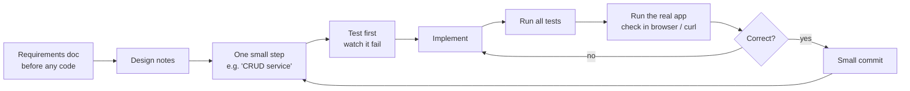

# How I used AI on this project

**Tool:** Claude Code (an agentic coding assistant that reads the repo, edits files, runs commands and tests).
**Principle:** the AI writes a lot of the code; I own the decisions, review every step, and nothing counts as done
until tests pass **and** it works in the running app.

## 1. Workflow

1. **Think before code.** The first two commits are documents only: the one-page requirements (including what is
   deliberately left out) and the design notes. The AI drafted them from the brief; I reviewed scope and trade-offs.
2. **Small, named steps.** Each request to the AI was one slice: backend skeleton, CRUD service, REST API, insights,
   seed, list page, form, insights page, packaging. Each slice ended in one focused commit, so the history shows
   how the solution evolved.
3. **TDD for logic.** For the domain rules (currency follows country, salary bands, insight maths, service rules)
   the test was written first and seen failing before the implementation.
4. **Verify the real thing, not just tests.** After each slice the app was run: API calls with `curl`, UI pages in a
   browser (search, add, edit, delete, insights), timings measured. Several bugs below were only visible this way.

## 2. What was delegated vs. decided

| Delegated to the AI | Kept under my control (reviewed / decided) |
|---------------------|---------------------------------------------|
| Boilerplate: Maven/Angular scaffolding, entities, DTOs, controllers, Material templates | Scope and what to leave out (auth, FX conversion, payroll, import, history) |
| First drafts of tests and of the docs | Domain rules: currency derived from country, money as `BigDecimal`, bands per country range |
| Seed data generator (names, weights, salary ranges) | Architecture: layered backend, SQL aggregation, single deployable, SQLite |
| CSS / layout polish | Accepting or rejecting each change; final wording of the docs |

## 3. Where the AI got it wrong, and how it was caught

These are the useful part: each was caught by a test, a measurement or by looking at the running app.

| # | Problem | How it was caught | Fix |
|---|---------|-------------------|-----|
| 1 | **Seeding 10,000 rows took 35.7 s** instead of ~1 s. `run()` called `seedIfEmpty()` on the same object, so Spring's `@Transactional` proxy was bypassed and every insert auto-committed. | Measured the startup log instead of trusting "should be about a second". | Made `run()` itself transactional: **0.59 s** (60× faster). Recorded in DESIGN.md. |
| 2 | The catch-all exception handler would have turned Spring's own 404/405 errors into **500s**. | Reviewing the handler, then a test: wrong HTTP method must stay 405. | Pass through exceptions that already carry a status (`ErrorResponse`). |
| 3 | Sorting by an unknown field (`sort=password`) would have returned **500**. | Writing negative-path controller tests. | Map `PropertyReferenceException` to 400. |
| 4 | The UI showed country codes ("INDIA") and the delete dialog said "INDIA". | Looking at the page in a browser. | API returns `countryName`; UI uses it. |
| 5 | Seed names repeated heavily (the first page was the same name 8 times), which looks fake in a demo. | Looking at the sorted list. | Larger region-specific name pools (~2,000 combinations per region). |
| 6 | Form hints overlapped the next row's labels, and a field with a hint stretched its neighbour. | Screenshot review. | `subscriptSizing="dynamic"` + `align-items: start`. |
| 7 | "1 employees match" (grammar), and salary-band counts that read like labels for the next band. | Screenshot review. | Pluralisation; count on the same line as its band. |
| 8 | A test expected `/` to return the page body, but MockMvc records forwards instead of following them. | Failing test. | Assert `forwardedUrl("index.html")`; verified the real jar serves `/` correctly. |
| 9 | Karma could not launch headless Edge on this machine. | Test run hung. | Documented `KARMA_MANUAL=1` (open the runner in any browser); tests themselves were fine (16/16). |

## 4. Prompts

The conversation was step-by-step, and my own prompts were short. Paraphrased in order:

1. *"First tell me what their question is and what they expect from my side."* → the AI summarised the brief and
   proposed a plan: stack, scope, commit sequence and a clarifying-questions email.
2. *"Start with the requirements document."*
3. *"Continue with the design doc."*
4. *"Continue with the backend skeleton"* → *"CRUD service"* → *"REST API"* → *"salary insights"* → *"seed script"*.
5. *"Continue with the Angular frontend"* → form → insights page.
6. *"Continue with packaging and Dockerfile"* → *"README and AI workflow docs"*.

Short prompts worked because the plan from step 1 set the working rules for every later step. These rules were
proposed by the AI and accepted by me: keep it simple (judgement over complexity), test first for business rules,
one small commit per step, `BigDecimal` for money, aggregation in SQL, one consistent error format and no stack
traces to the client, deterministic tests on small datasets, run the real app after each step and report measured
results, and explain every decision so I can defend it.

## 5. What I would not delegate
- Deciding what *not* to build and explaining why (product judgement).
- Trusting a performance claim without measuring it (see #1).
- Accepting UI work without looking at it (see #4–#7).
