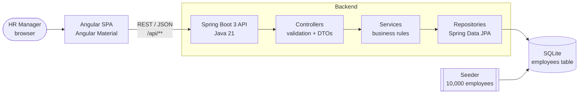

# Salary Management — Design Notes

Companion to [`REQUIREMENTS.md`](REQUIREMENTS.md). This explains **how** v1 is built and **why**.

## 1. Architecture



**One deployable unit.** The Angular build is copied into the Spring Boot jar (`static/`), so the API and UI
ship together: one URL, no CORS, one thing to deploy and run. For a 1-user internal tool this beats running
two services. They can be split later if the UI needs its own release cycle.

**Layering.** Controller → Service → Repository. Controllers only map HTTP ↔ DTOs and validate input.
Services hold the rules (e.g. currency must match the country). Repositories only talk to the DB. Each layer is
testable on its own.

## 2. Data model

One table is enough for v1. Normalising country / job title into lookup tables was considered and rejected
for now: it adds joins and admin screens without helping the HR Manager's questions.

| Column | Type | Rules |
|--------|------|-------|
| `id` | INTEGER PK | auto-generated |
| `full_name` | TEXT | required, 2–100 chars |
| `job_title` | TEXT | required |
| `department` | TEXT | required |
| `country` | TEXT | required, from a supported list |
| `currency` | TEXT(3) | ISO 4217, **derived from country** (not typed by the user) |
| `salary` | DECIMAL(12,2) | required, > 0, annual gross |
| `employment_type` | TEXT | `FULL_TIME` / `PART_TIME` / `CONTRACT` |
| `hire_date` | DATE | required, not in the future |
| `created_at`, `updated_at` | TIMESTAMP | set by the app |

**Indexes:** `(country)`, `(country, job_title)`, `(full_name)`. These cover the filters and the GROUP BY queries.

**Money:** `BigDecimal` in Java and DECIMAL in the DB. Never `double` for salaries (rounding errors).

**Currency follows country** (`CountryCurrency` enum: India → INR, USA → USD, UK → GBP, …). This stops data
like "India, USD" from being entered and is what makes per-country insights trustworthy.

## 3. REST API

| Method | Path | Purpose |
|--------|------|---------|
| GET | `/api/employees?search=&country=&jobTitle=&department=&page=0&size=20&sort=fullName,asc` | Paged, filtered list |
| GET | `/api/employees/{id}` | One employee |
| POST | `/api/employees` | Create (201 + Location) |
| PUT | `/api/employees/{id}` | Update |
| DELETE | `/api/employees/{id}` | Delete (204) |
| GET | `/api/insights/countries` | Min / max / avg salary + headcount per country |
| GET | `/api/insights/countries/{country}/job-titles` | Avg / min / max per job title in a country |
| GET | `/api/insights/countries/{country}/distribution` | Headcount per salary band in a country |
| GET | `/api/meta` | Supported countries, departments, job titles, employment types (for UI dropdowns) |

**Errors** use one shape everywhere (RFC 7807 `ProblemDetail`):
```json
{ "status": 400, "title": "Validation failed", "errors": { "salary": "must be greater than 0" } }
```
404 for unknown employee, 400 for validation, 500 never leaks stack traces.

## 4. Insights — done in SQL

Aggregation runs in the database with `GROUP BY`, not by loading 10k rows into Java:
```sql
SELECT country, currency, COUNT(*), MIN(salary), MAX(salary), AVG(salary)
FROM employees GROUP BY country, currency ORDER BY country;
```
Results come back as small projection records (one row per country), so the API stays fast and memory use stays flat
as headcount grows. **Salary bands** are computed relative to the country's own range (e.g. 5 equal-width bands
between that country's min and max), because a fixed band like "50k–60k" means nothing across INR and USD.

## 5. Seeding 10,000 employees
- A Spring `CommandLineRunner` that runs **only when the table is empty** (safe to restart) and is disabled in tests.
- Names from `first_names.txt` × `last_names.txt`. Country, title and department are picked by weight
  (e.g. more engineers than lawyers). Salary comes from a per-country, per-title base range plus seniority variance.
- **Fixed random seed**, so every run produces the same data. Demos and bug reports are reproducible.
- Inserted with JDBC **batch inserts** (1,000 per batch) in a single transaction: seconds instead of minutes.

## 6. Frontend (Angular)
- **Pages:** Employees (table + filters + paging), Employee form (add/edit, reactive form validation),
  Insights (country table, job-title drill-down, distribution chart).
- **Server-side paging/sorting**, so the browser never holds 10k rows. Search input is debounced (300 ms).
- One `EmployeeService` / `InsightsService` per API area; components stay presentational.

## 7. Testing strategy
| Level | Tool | What it proves |
|-------|------|----------------|
| Unit | JUnit 5 + Mockito | Service rules: currency derived from country, validation, not-found handling, salary band maths |
| Web slice | `@WebMvcTest` | Status codes, validation messages, error format, paging params |
| Repository | `@DataJpaTest` on SQLite | Insight queries return correct min/max/avg on a small known dataset |
| UI | Angular unit tests | Form validation and service calls |

Tests use **small, hand-built datasets** (not the 10k seed), so they are fast, deterministic and the expected numbers
are easy to check by eye. TDD for the service and insight logic.

## 8. Trade-offs and what I'd do next
- **SQLite** is perfect for one user and 10k rows; with many concurrent writers I'd move to PostgreSQL
  (only the datasource config changes, thanks to JPA).
- **No auth** in v1. Next: SSO + an HR role, then an audit log of salary changes.
- **Per-country currency only.** Next: optional conversion to a reporting currency with dated FX rates.
- **Hard delete.** Next: soft delete / archive for leavers, to keep history.
